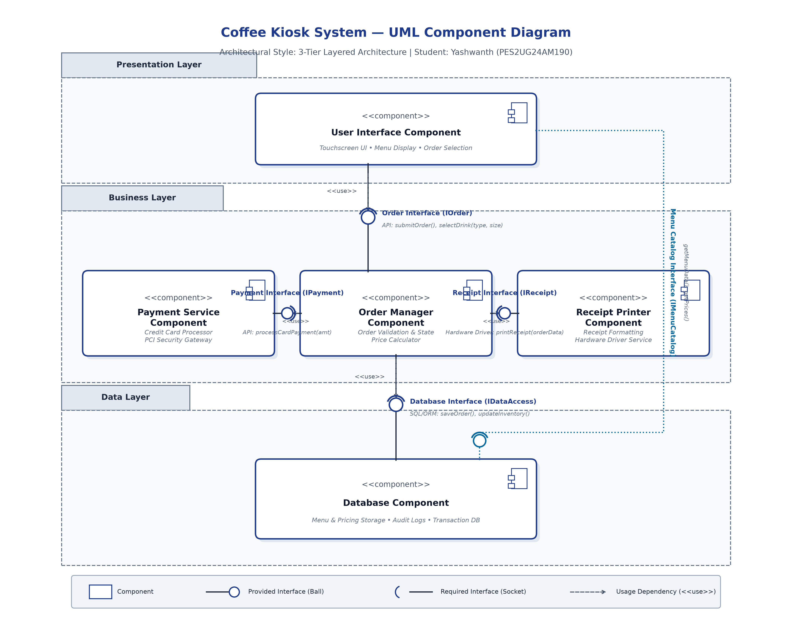

# SE Lab 3: Component Modelling & Architectural Pattern Selection

**Course:** UE22CS252 - Software Engineering Lab  
**Institution:** PES University, Department of Computer Science & Engineering  
**Student Name:** Yashwanth  
**SRN:** PES2UG24AM190  
**GitHub Username:** [Jamesbond0070](https://github.com/Jamesbond0070)  
**Assigned Scenario:** **Scenario 4: Self-Service Coffee Kiosk System**  

---

## 📌 1. Project Overview & Scenario Requirements

This repository contains the complete component-based architectural design and justification for a **Self-Service Coffee Kiosk System** deployed in retail cafés and transit hubs.

### System Specifications & Constraints:
* **Beverage Varieties:** Supports **3 coffee types** (`Espresso`, `Americano`, and `Latte`).
* **Serving Sizes:** Each beverage is available in **2 sizes** (`Small` and `Large`), with dynamic pricing calculations.
* **Payment Processing:** **Credit card only** via an integrated EMV chip/contactless reader.
* **Physical Output:** Thermal **Receipt Printer** for physical transaction receipts.
* **Customer Interaction:** High-responsiveness **Touchscreen** interface.
* **Data Storage:** **Local menu & pricing database** ensuring 100% offline autonomy.

---

## 🏗️ 2. Architectural Pattern Selection & Justification

### Architectural Choice:
> **"We chose Layered Architecture for the Self-Service Coffee Kiosk System."**

The Self-Service Coffee Kiosk is an autonomous, embedded physical appliance. A **3-Tier Layered Architecture** (Presentation Layer, Business Logic Layer, and Data / Peripheral Hardware Layer) partitions the system into clean, loosely coupled horizontal strata with strict unidirectional dependencies. This eliminates the operational overhead, network latency, and distributed failure modes of Microservices, while removing the external network dependency and single-point-of-failure vulnerability of Client-Server architectures.

### Two Scenario-Related Reasons:
1. **Hardware Abstraction & Peripheral Isolation:**  
   The scenario mandates physical peripheral devices: a Touchscreen interface, an EMV/NFC Credit Card reader, and a Thermal Receipt Printer. Layered Architecture encapsulates these physical devices behind standardized business/hardware interfaces (`IPayment` and `IReceipt`). If peripheral drivers, serial port baud rates, or POS terminal SDKs change, modifications remain isolated strictly within the Payment Service or Receipt Printer components, preventing ripple effects into order calculation or user display logic.
2. **Standalone High Availability & Offline Autonomy:**  
   The coffee kiosk must serve walk-up customers deterministically without relying on constant external cloud connectivity. By encapsulating menu items (`Espresso`, `Americano`, `Latte`), pricing tiers (`Small`, `Large`), and sales audits within a localized Database Component via `IDataAccess`, the system operates with complete offline autonomy. In contrast, tightly coupled client-server systems halt whenever venue Wi-Fi or LTE links falter, making the layered standalone model essential for uninterrupted retail operations.

### Security Advantage:
* **Strict PCI-DSS Compliance & Cardholder Data Isolation:**  
  Because the coffee kiosk exclusively accepts credit card payments, regulatory compliance (PCI-DSS) and cryptographic isolation are paramount. Under Layered Architecture, unidirectional call chains strictly prevent the User Interface Component and the general Database Component from touching, processing, or storing raw cardholder data (PAN, CVV, or PIN blocks). The Payment Service Component directly bridges the point-of-sale reader and banking tokenization gateway. Financial tokens remain strictly segregated from the local menu database, drastically reducing the compliance audit footprint and eliminating memory-scraping threat vectors.

### Performance Benefit:
* **Sub-50ms Touchscreen Response via In-Process IPC:**  
  Customer queue throughput hinges upon instantaneous, fluid touchscreen responsiveness. Because all five kiosk components run on the same physical computing node, cross-tier communication is executed via zero-overhead in-memory method invocations and local IPC rather than costly HTTP/REST serialization over a network. Beverage queries, size adjustments, and real-time total calculations resolve in sub-millisecond time, guaranteeing an end-to-end touch latency well under 50ms (sustaining 60 FPS UI transitions) to prevent queue congestion.

---

## 📊 3. Architectural Pattern Comparative Matrix

| Evaluation Criterion | Layered Architecture (Selected) | Microservices Architecture | Client-Server Architecture |
| :--- | :--- | :--- | :--- |
| **Target Deployment** | **Single embedded kiosk terminal (Optimal)** | Distributed cloud cluster (Overkill) | Remote centralized server (Fragile) |
| **Inter-Module Latency** | **Sub-millisecond (In-memory calls)** | 50–200ms (HTTP/gRPC network hops) | 20–150ms (WAN/LAN network roundtrips) |
| **Hardware Coupling** | **Clean abstraction behind drivers/services** | Complex container device-passthrough | Server cannot directly access peripherals |
| **Offline Autonomy** | **100% operational during network outages** | Fails if service mesh/registry drops | Total stoppage when network drops |
| **PCI-DSS Scoping** | **Isolated inside Payment Service Component** | Requires securing service-to-service mesh | Transmits card numbers across external WAN |
| **Operational Complexity** | **Low: Single executable runtime** | Very High: Docker, Kubernetes, Consul | Medium: Synchronized server API contracts |

---

## 🧩 4. Component Decomposition (5 Components)

```
+-----------------------------------------------------------------------------------+
|                                PRESENTATION LAYER                                 |
|  +-----------------------------------------------------------------------------+  |
|  |                     <<component>> User Interface Component                  |  |
|  |  * Touchscreen GUI  * Beverage Selection  * Size Selection  * Payment UI   |  |
|  +-----------------------------------------------------------------------------+  |
+------------------------------------------+----------------------------------------+
                                           | (IOrder, IMenuCatalog)
                                           v
+-----------------------------------------------------------------------------------+
|                                  BUSINESS LAYER                                   |
|  +-----------------------------------------------------------------------------+  |
|  |                     <<component>> Order Manager Component                   |  |
|  |  * Order State  * Pricing Engine  * Workflow Coordination  * Tax Logic     |  |
|  +-----------------------+-------------------------------+---------------------+  |
|                          |                               |                        |
|                          v (IPayment)                    v (IReceipt)             |
|  +----------------------------------+  +---------------------------------------+  |
|  |  <<component>> Payment Service   |  |   <<component>> Receipt Printer       |  |
|  |  * POS Reader Driver * PCI P2PE  |  |   * Thermal ESC/POS * Paper Sensor    |  |
|  +----------------------------------+  +---------------------------------------+  |
+------------------------------------------+----------------------------------------+
                                           | (IDataAccess)
                                           v
+-----------------------------------------------------------------------------------+
|                                    DATA LAYER                                     |
|  +-----------------------------------------------------------------------------+  |
|  |                       <<component>> Database Component                      |  |
|  |  * Menu & Pricing Catalog  * Sales Audits  * Offline Transaction Journal    |  |
|  +-----------------------------------------------------------------------------+  |
+-----------------------------------------------------------------------------------+
```

| Component Name | Layer | Stereotype | Primary Responsibilities | Provided Interfaces | Required Interfaces |
| :--- | :--- | :--- | :--- | :--- | :--- |
| **User Interface** | Presentation | `<<component>>` | Touchscreen event handling, menu rendering, size toggling, visual order summary | None | `IOrder`, `IMenuCatalog` |
| **Order Manager** | Business | `<<component>>` | Order state management, tax & total computation, orchestrating payment & receipt flows | `IOrder` | `IPayment`, `IReceipt`, `IDataAccess` |
| **Payment Service** | Business / Hardware | `<<component>>` | Controls EMV/NFC card terminal, tokenization, transaction authorization | `IPayment` | None |
| **Receipt Printer** | Business / Hardware | `<<component>>` | Generates ESC/POS receipt data, drives thermal head, checks paper sensor | `IReceipt` | None |
| **Database** | Data Persistence | `<<component>>` | Stores beverage pricing, sizes, audit trails, and offline orders in local SQLite | `IDataAccess`, `IMenuCatalog` | None |

---

## 🔌 5. Interface Specifications (5 Interfaces)

| Interface Name | Provider | Consumer | Methods & Signatures | Description & Error Handling |
| :--- | :--- | :--- | :--- | :--- |
| `IOrder` | Order Manager | User Interface | `addItem(coffeeType: String, size: Size): OrderID`<br/>`calculateTotal(orderID: UUID): Decimal`<br/>`checkout(orderID: UUID): OrderStatus` | Creates and updates line items; calculates totals including local taxes; returns validation errors. |
| `IPayment` | Payment Service | Order Manager | `initializeReader(): Status`<br/>`processPayment(amount: Decimal, orderID: UUID): TransactionResult`<br/>`refund(txID: UUID): Boolean` | Handles EMV card insertion/tap, communicates with bank tokenization gateway; returns `CARD_DECLINED` or `TIMEOUT`. |
| `IReceipt` | Receipt Printer | Order Manager | `printReceipt(orderSummary: OrderDTO): PrintStatus`<br/>`checkPaperStatus(): SensorStatus` | Formats thermal receipt slip, triggers cutting knife; raises `OUT_OF_PAPER` warnings. |
| `IDataAccess` | Database | Order Manager | `saveOrder(orderRecord: OrderEntity): Boolean`<br/>`updateInventory(coffeeType: String, qty: Int): Status`<br/>`logTransaction(txData: AuditRecord): Void` | Persists completed sales and updates ingredient usage within an ACID transactional boundary. |
| `IMenuCatalog` | Database | User Interface | `getAvailableItems(): List<CoffeeItem>`<br/>`getItemPrice(coffeeType: String, size: Size): Decimal` | Provides menu catalog items (Espresso, Americano, Latte) and size pricing to the UI layer. |

---

## 🖼️ 6. UML 2.0 Component Diagram

The UML Component Diagram adheres strictly to UML 2.0 notation, utilizing ball (provided) and socket (required) assembly connectors, ports, stereotypes, and layer boundaries.



*Editable vector diagram available in: [`Coffee_Kiosk_Component_Diagram.drawio`](Coffee_Kiosk_Component_Diagram.drawio)*  
*Vector PDF printable diagram: [`Coffee_Kiosk_Component_Diagram.pdf`](Coffee_Kiosk_Component_Diagram.pdf)*

---

## 📁 7. Repository Structure & Deliverables

```
SE-Lab-3/
├── README.md                               # Comprehensive Project Overview & Architecture Guide
├── .gitignore                              # Git ignore rules for OS & temporary files
├── Coffee_Kiosk_Component_Diagram.png      # High-Resolution 300 DPI UML Component Diagram
├── Coffee_Kiosk_Component_Diagram.pdf      # Vector PDF version of UML Component Diagram
├── Coffee_Kiosk_Component_Diagram.svg      # Vector SVG version of UML Component Diagram
├── Coffee_Kiosk_Component_Diagram.drawio   # Native Draw.io XML editable source file
├── Architectural_Justification_Document.docx # 1-Page Written Justification Document (Word Format)
├── Architectural_Justification_Document.pdf  # 1-Page Written Justification Document (PDF Format)
└── Lab3_Complete_Report.pdf                # Full 5-Page Comprehensive Lab Report with Tables & Diagram
```

---

## 🎓 8. Academic Integrity & Course Information

* **Course Code:** UE22CS252 (Software Engineering Lab)
* **Semester / Year:** 2026 Academic Year
* **Department:** Computer Science & Engineering, PES University, Bangalore, India
* **Author:** Yashwanth (PES2UG24AM190)
